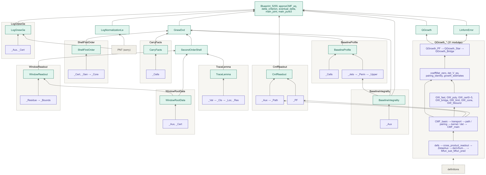
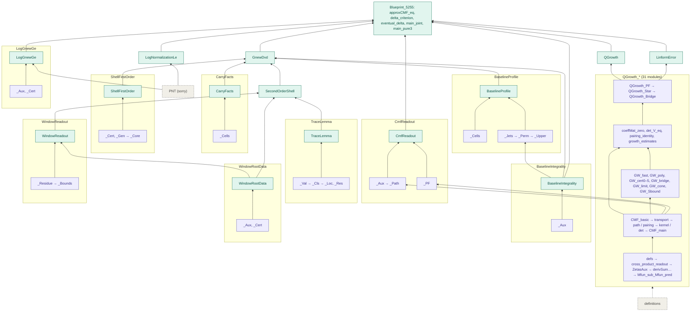
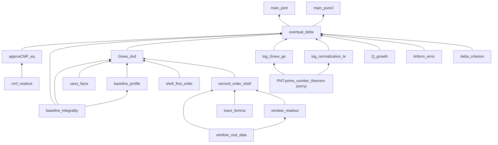

# Dependency graph (Lean, `lean/Meijer5255`)

Final state, 2026-10-13. 70 Lean files; everything builds; the only `sorry` is
`PNT.prime_number_theorem` (`#print axioms main_joint` / `main_pure3` =
`[propext, sorryAx, Classical.choice, Quot.sound]`, `sorryAx` from PNT only). Arrows point from a
module/theorem to its users (bottom-up toward the main theorems). The diagrams are Mermaid; they
render on GitHub and in VS Code's Markdown preview. Rendered images (Mermaid 11.4.1, 2× PNG and
SVG): `dependency_graph_files.{png,svg}`, `dependency_graph_theorems.{png,svg}`,
`dependency_graph_imports.{png,svg}` (this directory).

## 1. File-level graph (condensed; as shown in the session)

Helper modules are grouped under the node file they serve; the 31 `QGrowth_*` modules are drawn as
five chains. Edges from `definitions.lean` (imported by every node file) are omitted except one.
Green = node file, purple = helper modules, dashed grey = `definitions` / `PNT`.

## 2. Theorem-level graph (blueprint nodes → main theorems)

All nodes are proved; `log_Gnew_ge`, `log_normalization_le` (and hence the main theorems) use the
prime number theorem.

## 3. Exact import graph (all 70 files, generated from the `import` lines)

```mermaid
flowchart BT
definitions --> BaselineIntegrality
BaselineIntegrality_Aux --> BaselineIntegrality
definitions --> BaselineIntegrality_Aux
definitions --> BaselineProfile
BaselineIntegrality --> BaselineProfile
BaselineProfile_Cells --> BaselineProfile
BaselineProfile_Upper --> BaselineProfile
definitions --> BaselineProfile_Cells
definitions --> BaselineProfile_Jets
BaselineIntegrality --> BaselineProfile_Jets
BaselineProfile_Jets --> BaselineProfile_Perm
BaselineProfile_Perm --> BaselineProfile_Upper
definitions --> Blueprint_5255
CmfReadout --> Blueprint_5255
BaselineIntegrality --> Blueprint_5255
CarryFacts --> Blueprint_5255
BaselineProfile --> Blueprint_5255
ShellFirstOrder --> Blueprint_5255
SecondOrderShell --> Blueprint_5255
GnewDvd --> Blueprint_5255
LogGnewGe --> Blueprint_5255
LogNormalizationLe --> Blueprint_5255
QGrowth --> Blueprint_5255
LinformError --> Blueprint_5255
definitions --> CarryFacts
CarryFacts_Cells --> CarryFacts
definitions --> CarryFacts_Cells
definitions --> CmfReadout
CmfReadout_Aux --> CmfReadout
CmfReadout_PF --> CmfReadout
CmfReadout_Path --> CmfReadout
definitions --> CmfReadout_Aux
QGrowth_CMF_basic --> CmfReadout_Aux
definitions --> CmfReadout_PF
QGrowth_CMF_basic --> CmfReadout_PF
CmfReadout_Aux --> CmfReadout_Path
definitions --> GnewDvd
BaselineIntegrality --> GnewDvd
CarryFacts --> GnewDvd
BaselineProfile --> GnewDvd
ShellFirstOrder --> GnewDvd
SecondOrderShell --> GnewDvd
definitions --> LinformError
QGrowth_Bridge --> LinformError
definitions --> LogGnewGe
PNT --> LogGnewGe
LogGnewGe_Aux --> LogGnewGe
LogGnewGe_Cert --> LogGnewGe
definitions --> LogGnewGe_Aux
definitions --> LogGnewGe_Cert
definitions --> LogNormalizationLe
PNT --> LogNormalizationLe
definitions --> QGrowth
QGrowth_Bridge --> QGrowth
definitions --> QGrowth_Bridge
QGrowth_Star --> QGrowth_Bridge
QGrowth_growth_estimates --> QGrowth_Bridge
QGrowth_Mfun_sub_Mfun_pred --> QGrowth_CMF_basic
QGrowth_CMF_path --> QGrowth_CMF_det
QGrowth_CMF_pairing --> QGrowth_CMF_det
QGrowth_CMF_path --> QGrowth_CMF_kernel
QGrowth_CMF_pairing --> QGrowth_CMF_kernel
QGrowth_CMF_kernel --> QGrowth_CMF_main
QGrowth_CMF_det --> QGrowth_CMF_main
QGrowth_coeffMat_zero --> QGrowth_CMF_main
QGrowth_CMF_transport --> QGrowth_CMF_pairing
QGrowth_CMF_transport --> QGrowth_CMF_path
QGrowth_CMF_basic --> QGrowth_CMF_transport
QGrowth_Mfun_sub_Mfun_pred --> QGrowth_GW_Sbound
QGrowth_GW_poly --> QGrowth_GW_bridge
QGrowth_GW_cert0 --> QGrowth_GW_bridge
QGrowth_GW_cert1 --> QGrowth_GW_bridge
QGrowth_GW_cert2 --> QGrowth_GW_bridge
QGrowth_GW_cert3 --> QGrowth_GW_bridge
QGrowth_GW_cert4 --> QGrowth_GW_bridge
QGrowth_GW_cert5 --> QGrowth_GW_bridge
QGrowth_CMF_main --> QGrowth_GW_bridge
QGrowth_GW_fast --> QGrowth_GW_cert0
QGrowth_GW_fast --> QGrowth_GW_cert1
QGrowth_GW_fast --> QGrowth_GW_cert2
QGrowth_GW_fast --> QGrowth_GW_cert3
QGrowth_GW_fast --> QGrowth_GW_cert4
QGrowth_GW_fast --> QGrowth_GW_cert5
QGrowth_GW_bridge --> QGrowth_GW_limit
QGrowth_GW_fast --> QGrowth_GW_poly
QGrowth_ZetasAux --> QGrowth_Mfun_sub_Mfun_pred
QGrowth_derivSum_eq_realize_Lfun --> QGrowth_Mfun_sub_Mfun_pred
QGrowth_CMF_main --> QGrowth_PF
QGrowth_PF --> QGrowth_Star
QGrowth_pairing_identity --> QGrowth_Star
QGrowth_cross_product_readout --> QGrowth_ZetasAux
QGrowth_cross_product_readout --> QGrowth_coeffMat_zero
QGrowth_defs --> QGrowth_cross_product_readout
QGrowth_ZetasAux --> QGrowth_derivSum_eq_realize_Lfun
QGrowth_ZetasAux --> QGrowth_det_V_eq
QGrowth_coeffMat_zero --> QGrowth_det_V_eq
QGrowth_CMF_main --> QGrowth_det_V_eq
QGrowth_ZetasAux --> QGrowth_growth_estimates
QGrowth_det_V_eq --> QGrowth_growth_estimates
QGrowth_GW_limit --> QGrowth_growth_estimates
QGrowth_GW_cone --> QGrowth_growth_estimates
QGrowth_GW_Sbound --> QGrowth_growth_estimates
QGrowth_ZetasAux --> QGrowth_pairing_identity
QGrowth_CMF_main --> QGrowth_pairing_identity
WindowRootData --> SecondOrderShell
TraceLemma --> SecondOrderShell
WindowReadout --> SecondOrderShell
definitions --> ShellFirstOrder
ShellFirstOrder_Cert --> ShellFirstOrder
ShellFirstOrder_Core --> ShellFirstOrder
ShellFirstOrder_Cert --> ShellFirstOrder_Core
ShellFirstOrder_Gen --> ShellFirstOrder_Core
definitions --> ShellFirstOrder_Gen
definitions --> TraceLemma
TraceLemma_Cls --> TraceLemma
TraceLemma_Res --> TraceLemma
TraceLemma_Loc --> TraceLemma
TraceLemma_Val --> TraceLemma_Cls
TraceLemma_Cls --> TraceLemma_Loc
definitions --> TraceLemma_Res
definitions --> TraceLemma_Val
definitions --> WindowReadout
WindowReadout_Residue --> WindowReadout
WindowReadout_Bounds --> WindowReadout
WindowRootData --> WindowReadout
WindowReadout_Residue --> WindowReadout_Bounds
definitions --> WindowReadout_Residue
definitions --> WindowRootData
WindowRootData_Aux --> WindowRootData
WindowRootData_Cert --> WindowRootData
definitions --> WindowRootData_Aux
definitions --> WindowRootData_Cert
```

